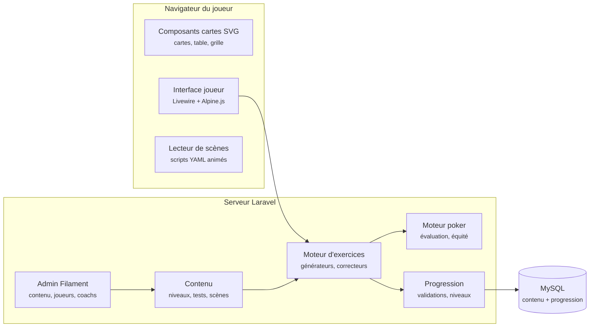
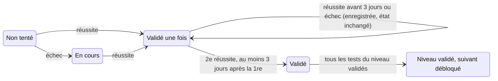

# Application d'entraînement au poker — architecture

4 novembre 2026 · Frédéric Peignot

L'application est un monolithe Laravel construit sur Laraskel : le serveur génère les exercices, corrige les réponses et tient la progression de chaque joueur ; le navigateur affiche les cartes et joue les animations. Un premier lot utilisable couvre les niveaux 1 à 3.

## Vue d'ensemble



Le joueur répond dans l'interface ; le moteur d'exercices, nourri par le contenu, corrige à l'aide du moteur poker et transmet le résultat au service de progression, seul à écrire l'état du joueur en base. L'administration Filament édite le contenu et donne aux coachs la vue sur leurs joueurs.

## Choix techniques

La pile retenue est celle de Laraskel : Laravel, Filament pour l'administration, Livewire et Alpine.js pour l'interface joueur, MySQL. Pas de SPA, pas d'API publique au départ : tout est rendu côté serveur, et le JavaScript se limite aux cartes et aux animations.

| Couche | Choix | Raison |
| --- | --- | --- |
| Base applicative | Laraskel (Laravel, Tailwind v4) | Squelette déjà prêt : authentification, multi-tenancy, Filament |
| Interface joueur | Livewire + Alpine.js | Exercices interactifs sans application JavaScript séparée |
| Administration et coach | Filament | Édition du contenu et suivi des joueurs sans écrire d'écrans |
| Cartes | Composants Blade générant du SVG | Net à toute taille, stylable en CSS, aucune image à gérer |
| Animations | CSS + Web Animations API, pilotées par un lecteur de scènes Alpine | Léger, sans dépendance ; GSAP en option si les scènes se compliquent |
| Moteur poker | Classes PHP maison : évaluateur de mains, équité par Monte-Carlo | Source de vérité côté serveur, testable avec PHPUnit |
| Base de données | MySQL | Pile connue, déjà en place sur le serveur |
| Tâches de fond | File d'attente Laravel (driver base de données) | Calculs d'équité lourds, imports d'historiques, notifications |
| Commentaires d'erreurs (option) | prism-php, déjà intégré à Laraskel | Expliquer une erreur en langage naturel ; la note reste calculée par le code |

**Principe directeur : le contenu est de la donnée.** Niveaux, compétences, tests, exercices et scènes animées sont décrits dans des fichiers YAML versionnés dans Git, chargés en base par un seeder et éditables ensuite dans Filament. Ajouter un exercice ou un niveau ne demande pas de code, seulement un générateur existant et des paramètres.

## Modèle de données

Deux familles de tables : le **contenu**, commun à tous et versionné, et la **progression**, propre à chaque joueur. Un joueur ne lit jamais que ses propres lignes de progression.

### Contenu (commun)

| Table | Rôle | Colonnes principales |
| --- | --- | --- |
| `levels` | Les 6 niveaux | numéro, titre, objectif, durée indicative |
| `competences` | Les 31 compétences (C1.1…) | code, niveau, titre, leçon (Markdown), scène associée |
| `scenes` | Animations pédagogiques | code, script d'étapes (JSON) |
| `exercise_types` | Générateurs disponibles | code, classe PHP du générateur, schéma des paramètres |
| `tests` | Tests de passage d'un niveau | niveau, libellé, type d'exercice, paramètres (JSON), nombre de questions, seuil de réussite, temps limite, mode (`auto` ou `declare`) |
| `test_competence` | Compétences couvertes par un test | test, compétence |

### Progression (par joueur)

| Table | Rôle | Colonnes principales |
| --- | --- | --- |
| `users` | Joueurs, coachs, admins | nom, e-mail, rôle, club |
| `attempts` | Chaque passage d'un exercice ou d'un test | joueur, test ou exercice libre, graine aléatoire, questions générées, réponses, score, durée, réussi, date |
| `validations` | Réussites qui comptent pour un test | joueur, test, tentative, rang (1 ou 2), date |
| `progress` | État calculé, pour un affichage rapide | joueur, compétence ou niveau, statut, date |
| `journal_entries` | Journal de sessions | joueur, date, volume joué, niveau, test, erreur principale, émotion de 1 à 10 |
| `clubs` | Regroupement optionnel de joueurs | nom, coach référent |

La table `progress` est un cache : elle se recalcule entièrement à partir de `validations`. En cas de règle modifiée (par exemple passer de 3 à 2 jours d'écart), une commande Artisan recalcule tous les joueurs.

La graine aléatoire enregistrée dans `attempts` permet de régénérer exactement les mêmes questions : un joueur ou un coach peut revoir une tentative, et une contestation se règle en rejouant la correction.

## Exercices d'auto-évaluation

Une douzaine de générateurs couvrent tous les tests automatisables. Chaque générateur produit des questions à partir d'une graine, et un correcteur côté serveur les note : le navigateur ne connaît jamais la bonne réponse avant d'avoir répondu.

| Code | Exercice | Interaction | Niveau | Test servi |
| --- | --- | --- | --- | --- |
| E1 | Classer des mains | Glisser 5 mains dans l'ordre | 1 | 10 mains classées sans erreur |
| E2 | Meilleure main de 7 cartes | Toucher les 5 cartes qui forment la main | 1 | Exercice libre, chronométré |
| E3 | Trouver les nuts | Choisir parmi 4 propositions | 1 | Nuts sur 18 tableaux sur 20 |
| E4 | Pot annexe | Répartir les jetons entre pots | 1 | Expliquer un pot annexe à 3 joueurs |
| E5 | Décision préflop | Position + main → relance, call ou fold | 2 | 18 situations sur 20 |
| E6 | Grille de départ | Colorier la grille 13 × 13 de mémoire | 2 | Grille UTG et BTN de mémoire |
| E7 | Compter les outs | Saisir un nombre, cartes à toucher affichées ensuite | 3 | 20 tirages sans erreur |
| E8 | Call ou fold au chrono | Tirage + mise adverse, 10 s par décision | 3 | 18 décisions sur 20 en 10 s |
| E9 | Équités requises | Associer taille de mise et pourcentage | 3 | Tableau des équités requises |
| E10 | Calcul d'EV | Saisie numérique avec tolérance | 3 | EV d'un call simple |
| E11 | Texture et c-bet | Classer le flop, choisir la taille de mise | 4 | 10 flops classés |
| E12 | Range à la river | Scénario rédigé, répartir la range en fort, moyen, bluff | 5 | Ranges décrites sur 10 mains |
| E13 | MDF | Mise donnée → part de range à défendre | 6 | MDF face à 3 tailles |

### Tests qui ne se mesurent pas par un quiz

Certains tests portent sur le jeu réel : VPIP sur 500 mains, résultat sur 5 000 mains, bankroll tenue 2 mois, limite de perte respectée. Ils passent en mode `declare` :

- le joueur déclare la réussite et joint une preuve facultative (capture de statistiques, lignes du journal) ;
- un coach peut confirmer ou refuser, si le joueur appartient à un club ;
- plus tard, l'import d'historiques de mains (format texte des grands sites) permet de calculer VPIP et résultats automatiquement.

### Entraînement libre et tests

Chaque compétence propose un **entraînement** illimité, noté mais sans effet sur la progression, et un **test** officiel. Le test reprend le même générateur avec des paramètres fixes, un temps limite contrôlé par le serveur et un nombre de questions imposé. On s'entraîne autant qu'on veut ; seul le test compte.

## Cartes et animations

Toute la partie visuelle repose sur une petite bibliothèque de composants Blade, rendus en SVG, et sur un lecteur de scènes qui les anime pas à pas.

### Composants d'affichage

| Composant | Usage | Exemple |
| --- | --- | --- |
| `<x-card>` | Une carte : rang, couleur, face cachée, surlignée, grisée | `<x-card code="Ah" highlight />` |
| `<x-hand>` | Les 2 cartes d'un joueur | Main de départ, main adverse révélée |
| `<x-board>` | Flop, turn, river, avec emplacements vides | Tableau d'un exercice d'outs |
| `<x-table>` | Table ovale à 6 places, bouton, blinds, mises, pot | Leçon sur la position |
| `<x-range-grid>` | Grille 13 × 13 des mains de départ, cases colorées | Mains de départ, ranges adverses |
| `<x-odds-bar>` | Barre équité requise contre équité réelle | Cote du pot, décision call ou fold |
| `<x-chips>` | Piles de jetons et montants | Pot annexe, tailles de mise |

Les cartes ont un dessin original, à 4 couleurs en option (pique noir, cœur rouge, carreau bleu, trèfle vert), plus lisible pour les débutants et sur petit écran. Taille minimale de 44 px pour rester tactile sur mobile.

### Lecteur de scènes

Une scène est un script d'étapes décrit en YAML. Le lecteur, un composant Alpine, joue chaque étape avec les Web Animations API, et propose lecture, pause, étape suivante et précédente. Avec le réglage système « réduire les animations », les étapes s'affichent sans mouvement.

```yaml
code: outs-tirage-couleur
competence: C3.1
steps:
  - deal: { seat: hero, cards: [Ah, 8h] }
  - board: { flop: [Kh, 7h, 2c] }
  - caption: "Il vous manque un cœur pour la couleur."
  - reveal_deck: { filter: hearts, remaining: true }
  - highlight: { cards: deck.hearts, label: "9 outs" }
  - caption: "Règle du 4 : 9 × 4 = 36 %, valeur exacte 35 %."
  - odds_bar: { equity: 35, required: 25 }
```

### Scènes prévues

| Compétence | Scène |
| --- | --- |
| C1.1 | Une main complète : blinds, distribution, flop, turn, river, abattage |
| C1.3 | Les 10 combinaisons qui se construisent carte par carte |
| C1.2 | Pot annexe : un joueur à tapis, les jetons se répartissent en deux pots |
| C2.1 | Le bouton tourne, l'ordre de parole change autour de la table |
| C2.2 | La grille 13 × 13 qui s'élargit de UTG au bouton |
| C3.1 | Les outs qui s'allument dans le paquet |
| C3.3 | La barre de cote du pot qui se remplit selon la taille de la mise |
| C3.5 | Course d'équité : 1 000 tableaux simulés défilent, le pourcentage converge |
| C4.2 | Quatre flops côte à côte, les tirages possibles surlignés |
| C5.2 | La range adverse qui se réduit sur la grille à chaque action |
| C6.1 | MDF : la part de range à défendre selon la taille de mise |

## Suivi de progression

La progression applique exactement la règle du carnet : un test est validé après deux réussites séparées d'au moins 3 jours, et un niveau quand tous ses tests le sont.



Le service `ProgressService` est le seul à écrire dans `validations` et `progress`. Il est appelé à chaque tentative de test terminée :

1. Si la tentative échoue, elle est enregistrée et l'état passe à « En cours ».
2. Si elle réussit et qu'aucune validation n'existe, il crée la validation de rang 1.
3. Si elle réussit au moins 3 jours calendaires après la validation de rang 1, il crée la validation de rang 2 : le test est validé.
4. Il recalcule alors le statut des compétences couvertes par le test, puis celui du niveau.
5. Si le niveau est validé, le suivant se débloque et le joueur reçoit une notification.

**Ce que voit le joueur.** Un tableau de bord avec son niveau actuel, la grille des 31 compétences en couleur, le prochain test disponible et la date à partir de laquelle une seconde validation est possible. Une courbe montre ses scores d'entraînement dans le temps, par compétence.

**Niveaux débloqués.** Les leçons et entraînements de tous les niveaux restent consultables ; seuls les tests d'un niveau exigent que le précédent soit validé. On peut regarder plus loin, mais on ne saute pas d'étape.

## Multi-joueurs

Chaque joueur a son compte et sa propre progression ; rien n'est partagé sauf le contenu. Les clubs sont un regroupement optionnel, pas une condition pour jouer.

| Rôle | Peut | Ne peut pas |
| --- | --- | --- |
| Joueur | Suivre les leçons, s'entraîner, passer les tests, tenir son journal, exporter son carnet en PDF | Voir la progression des autres |
| Coach | Voir la progression des joueurs de son club, confirmer les tests déclaratifs, commenter une tentative | Modifier une tentative ou un score |
| Administrateur | Éditer le contenu, gérer clubs et comptes | Changer la progression sans trace |

**Isolation des données.** Toutes les tables de progression portent `user_id`. Un scope global Eloquent et des policies Laravel garantissent qu'un joueur ne lit que ses lignes, et qu'un coach ne lit que celles de son club.

**Clubs : multi-tenancy en base unique.** stancl/tenancy, déjà présent dans Laraskel, est utilisé en mode base unique avec une colonne `club_id`. Une base par club serait disproportionnée : le contenu est commun et les volumes sont faibles. Un joueur sans club reste dans l'espace public.

**Inscription.** E-mail et mot de passe, ou lien d'invitation d'un coach qui rattache directement au club. Les conditions d'utilisation réservent l'accès aux majeurs, le contenu touchant aux jeux d'argent.

**Données personnelles.** On ne stocke que le nom, l'e-mail et la progression. Le joueur peut exporter ses données (carnet PDF et JSON) et supprimer son compte, ce qui efface ses tentatives et son journal.

## Hébergement et exploitation

L'application tient sur le serveur `ratus80` existant (2 OCPU ARM, 12 Go, Hestia avec nginx et PHP-FPM), dans un domaine ou sous-domaine dédié.

- **Web** : nginx + PHP-FPM, certificat Let's Encrypt géré par Hestia.
- **Base** : MySQL, une base dédiée à l'application.
- **Tâches planifiées** : une ligne cron pour le scheduler Laravel (rappels, recalcul de `progress`, purge).
- **File d'attente** : un worker Laravel lancé par systemd, pour les simulations d'équité et les imports d'historiques.
- **Sauvegardes** : dump MySQL quotidien hors du serveur ; le contenu est déjà dans Git.
- **Déploiement** : `git pull`, `composer install`, `php artisan migrate`, `php artisan db:seed --class=ContentSeeder` pour recharger le contenu.

Charge attendue faible : les simulations Monte-Carlo de 10 000 tableaux restent sous la seconde en PHP, et sont mises en cache par situation.

## Plan de réalisation

Quatre lots, chacun utilisable seul et validé avant le suivant.

1. **Lot 1 — Socle et niveaux 1 à 3.** Comptes joueurs, contenu en YAML, composants cartes, lecteur de scènes, exercices E1 à E10, progression et tableau de bord. C'est déjà un produit complet pour un débutant.
2. **Lot 2 — Niveaux 4 et 5, journal.** Exercices E11 et E12, tests déclaratifs, journal de sessions, export du carnet en PDF.
3. **Lot 3 — Clubs et coachs.** Invitations, rattachement à un club, tableau de bord coach, confirmation des tests déclaratifs.
4. **Lot 4 — Niveau 6 et données de jeu réel.** Exercice E13, import d'historiques de mains, calcul automatique de VPIP et de résultats, commentaires d'erreurs par LLM.

Le moteur poker (évaluateur de mains, équité) se développe et se teste en premier, isolé, car tous les exercices en dépendent.

## Questions ouvertes

- [ ] Public visé : un club précis (lequel ?), plusieurs clubs, ou ouverture au grand public ?
- [ ] Gratuit pour tous, ou fonctions coach réservées aux clubs ?
- [ ] Usage surtout sur ordinateur ou sur téléphone ? Cela décide de la priorité d'une version installable (PWA) et hors ligne.
- [ ] Faut-il importer les historiques de mains dès le lot 2, ou les tests déclaratifs suffisent-ils au début ?
- [ ] Projet open source, comme GVV et Laraskel ?
